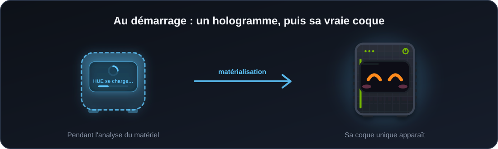
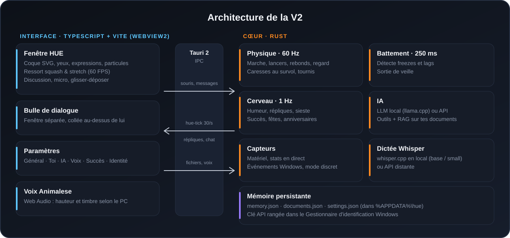

<p align="center">
  
</p>

**HUE est un compagnon de bureau vivant pour Windows.** C'est un petit personnage animé qui se balade sur ton écran, réagit à ce que fait ton PC, discute avec toi… et qui **incarne ta machine** : sa forme, sa voix et son caractère viennent de ton matériel. Deux PC différents n'auront jamais le même HUE.

Construit avec **Rust**, **Tauri 2**, **TypeScript** et **Vite**, par [Batpolygon](https://github.com/Batpolygon).

<p align="center">
  <a href="#-télécharger">Télécharger</a> ·
  <a href="#-v1--v2-en-un-coup-dœil">V1 → V2</a> ·
  <a href="#-nouveautés-de-la-v2">Nouveautés</a> ·
  <a href="#-utilisation">Utilisation</a> ·
  <a href="#-compiler-depuis-les-sources">Compiler</a> ·
  <a href="#-confidentialité">Confidentialité</a>
</p>

---

## 🔁 V1 → V2 en un coup d'œil

<p align="center">
  
</p>

| | V1 | V2 |
|---|---|---|
| **Apparence** | Une coque grise identique pour tous | Une coque **générée depuis ton matériel** : 6 formes, couleurs, motifs, LED, ailettes… |
| **Voix** | Animalese (hauteur et vitesse réglables) | + hauteur et timbre **propres à chaque PC** |
| **Personnalité** | Dérivée du matériel | 6 traits + un archétype (« Champion turbo », « Sage contemplatif »…) qui colore ses répliques |
| **Expressions** | Yeux et tournis | 8 expressions, rougissement, micro-animations, siestes |
| **Discussion** | Texte, via API ou modèle GGUF local | + **outils**, **mémoire persistante**, pensées spontanées |
| **Dictée vocale** | Non disponible | **Whisper**, en local ou via API |
| **Fichiers** | — | **Glisse un fichier sur lui** : résumé, avis, et il s'en souvient (RAG) |
| **Calendrier** | — | 20+ fêtes, **ton anniversaire** et **celui de ton PC** |
| **Succès** | — | 31 succès qui débloquent des **titres** (préfixe / suffixe) |
| **Réactions système** | Stats et événements Windows | + **freezes / lags** et sortie de veille |
| **Caresses** | Seulement en le traînant doucement | En **passant la souris** sur lui |
| **Démarrage** | Silencieux | Il te dit **bonjour**, après un **hologramme de chargement** |
| **Rebonds** | Écrasement fixe et saccadé | Selon la force du choc, avec un **effet gelée** fluide |
| **Clé API** | En clair dans `settings.json` | Dans le **Gestionnaire d'identification Windows** |
| **Livraison** | EXE seul | EXE portable **et** installeur, scripts `dev.bat` / `build.bat` |

---

## 📦 La V1

La première version posait les bases :

- Un personnage **sans cadre**, toujours au-dessus des fenêtres, qui se range sous la barre des tâches.
- Trois façons de bouger : **patrouille** sur l'écran, **marche** le long de la barre des tâches, ou **immobile**. On peut le glisser et le lancer.
- Des **réactions au PC** : processeur, mémoire, disque, batterie, réseau, événements système. Quand il est rangé, son écran affiche l'heure et des statistiques.
- Une **personnalité tirée du matériel** (processeur, RAM, carte graphique, disque).
- La **discussion par texte** avec une API compatible OpenAI ou un modèle **GGUF local** via `llama.cpp`.
- Une **voix Animalese** synthétisée.
- Un **mode discret** qui le cache en plein écran, dans les jeux et quand OBS tourne.
- Le **lancement au démarrage** de Windows.

Toutes ces bases sont toujours là en V2. Elles ont été corrigées, enrichies et rendues plus vivantes.

---

## ✨ Nouveautés de la V2

### 🧬 Un HUE unique par PC

L'écran noir et les yeux orange ne changent jamais : c'est toujours HUE. **Tout le reste de sa coque est calculé depuis ton matériel**, avec une « graine » propre à la machine pour départager deux PC identiques.

<p align="center">
  
</p>

- **Forme** : portable, tour, PC fixe, tout-en-un, mini-PC ou console portable, détectée automatiquement.
- **Voix** : les grosses cartes graphiques et les tours parlent plus grave, les petites machines plus aigu. Le timbre dépend de la marque du GPU (carré pour NVIDIA, dent de scie pour AMD, triangle pour Intel).
- **Personnalité** : six traits (énergie, curiosité, sociabilité, fierté, anxiété, fantaisie) donnent un archétype, par exemple *Champion turbo*, *Inventeur loufoque*, *Diva perfectionniste* ou *Sage contemplatif*. Il change ses répliques et son humeur.
- **Anniversaire du PC** : la date d'installation de Windows devient la date de naissance de HUE, et il la fête.

L'onglet **Identité** des paramètres montre sa fiche complète : portrait, archétype, traits, voix et matériel.

### 💛 Plus vivant

<p align="center">
  
</p>

- **Humeur** : elle évolue avec ce qui se passe (caresses, charge du PC, heure, solitude…). Elle se voit dans ses yeux, sa voix, son rougissement et sa vitesse de marche.
- **Micro-animations** : bâillement, dandinement, étirement, petite danse, regard curieux, petit saut.
- **Sieste** : il s'endort quand tu t'absentes (le délai se règle) et se réveille à ton retour.
- **Freezes et lags** : quand le PC se fige, il le remarque et réagit. Pareil quand l'ordinateur sort de veille.
- **Bonjour au démarrage** : il te salue à chaque lancement, et la toute première fois il se présente.
- **Fêtes et saisons** :
  - **Anniversaires** : le tien (à renseigner dans *Toi*), celui de ton PC, et votre « anniversaire d'amitié ».
  - **Calendrier** : Nouvel an, Chandeleur, Saint-Valentin, jour de Pi, 1er avril, fête de la musique, 14 juillet, Halloween, Avent, Noël, vendredi 13, journée des programmeurs…
  - **Ambiance** : un chapeau (bonnet de Noël, chapeau de sorcière, chapeau de fête, couronne, fleur) et des particules (neige, cœurs, confettis, feuilles, notes).
- **Pensées spontanées** : si un modèle est chargé, il lâche de temps en temps une vraie réflexion générée par l'IA.

Quand il est **rangé** dans le coin de l'écran, son écran fait défiler l'heure, tes statistiques et son humeur en petits visages :

<p align="center">
  
</p>

### 🤝 Plus interactif

- **Glisse un fichier sur lui** : il le lit, le **résume**, donne **son avis**, puis le garde en mémoire pour répondre à tes questions dessus (RAG local).
  - **Formats** : texte, code, Markdown, CSV, JSON, PDF, Word, OpenDocument, PowerPoint, Excel…
  - Jusqu'à 20 documents mémorisés.
- **Outils (tool calling)** : quand tu lui parles, il peut agir. Les actions sensibles te demandent toujours **confirmation** (barre Oui / Non).

  | Ce que tu peux lui demander | Exemples |
  |---|---|
  | L'état du PC | « Qu'est-ce qui mange mon CPU ? » |
  | Minuteurs | « Rappelle-moi le thé dans 4 minutes » |
  | Se souvenir / oublier | « Retiens que je préfère le café » |
  | Chercher dans tes documents | « Que dit mon rapport sur le budget ? » |
  | Ouvrir une appli ou un site *(confirmation)* | « Ouvre la calculatrice » |
  | Nettoyer les fichiers temporaires *(confirmation)* | « Fais un peu de ménage » |
  | Changer un réglage, ton anniversaire, son titre | « Parle moins souvent » |
  | Lui-même | « Va dormir », « Danse ! », « Range-toi » |

- **Dictée Whisper** : clique sur 🎙 et parle.
  - **En local** avec `whisper.cpp` : modèle *Base* (~60 Mo, rapide) ou *Small* (~180 Mo, précis), téléchargé une seule fois et vérifié par SHA-256.
  - **Ou via une API**.
  - Langues : français, anglais ou détection automatique.
- **Mémoire persistante** : il retient ce que tu lui confies, votre conversation récente et vos statistiques ensemble. Tout est visible et effaçable dans l'onglet **Toi**.
- **Succès et titres** : 31 succès, dont 5 secrets. Chacun débloque un **titre** que HUE peut porter :

  | Succès | Comment | Titre |
  |---|---|---|
  | Première caresse | Le caresser avec la souris | **Doux** *(préfixe)* |
  | Voltige | Le lancer 10 fois | **le Voltigeur** *(suffixe)* |
  | Survivant | Survivre à un freeze du PC | **le Survivant** *(suffixe)* |
  | Oiseau de nuit | Discuter entre 2 h et 5 h | **le Noctambule** *(suffixe)* |
  | Vieux copains | 30 jours ensemble | **Vétéran** *(préfixe)* |
  | Une année ensemble | 365 jours ensemble | **Légendaire** *(préfixe)* |

  Par exemple : *« Doux HUE le Survivant »*.

### 🪄 Les finitions de la 2.0

<p align="center">
  
</p>

- **Hologramme de chargement** : pendant l'analyse du matériel, une silhouette bleue transparente affiche « HUE se charge… ». Ensuite sa vraie coque se **matérialise**, au lieu d'apparaître d'un coup.
- **Rebonds en gelée** : l'écrasement dépend de la force du choc, puis un ressort amorti le fait rebondir et se stabiliser en douceur. Sa position est mise à jour 60 fois par seconde, pour des lancers fluides.

<p align="center">
  
</p>

- **Plus de flip** : sa coque ne se retourne plus quand il te regarde, seuls ses yeux te suivent.
- **Multi-écran** : lancé fort, il reste sur **son** écran et rebondit contre le bord, au lieu de disparaître sur l'autre écran pendant quelques secondes.
- **Caresses au survol** : passe la souris plusieurs fois sur lui, sans cliquer.
- **Sécurité** :
  - La clé API va dans le **Gestionnaire d'identification Windows**, jamais en clair.
  - Les moteurs `llama.cpp` et `whisper.cpp` sont **vérifiés par SHA-256**.
  - L'interface a une politique de sécurité (CSP) stricte.

---

## 📥 Télécharger

Récupère la dernière version sur la [page des releases](https://github.com/Batpolygon/HUE/releases). :

- **`HUE_V2.exe`** : la version portable. Lance-la directement, sans installation.

L'icône dans la zone de notification permet d'**afficher**, **ranger**, **redémarrer** ou **quitter** HUE.

> La V1 reste disponible dans la [release d'origine](https://github.com/Batpolygon/HUE/releases/tag/OfficialRelease).

---

## 🐾 Utilisation

| Geste | Effet |
|---|---|
| **Clic** | Ouvre la discussion. Un nouveau clic la referme. |
| **Double-clic** | Petit saut de joie. |
| **Survol en va-et-vient** | Une caresse : il rougit et adore ça 💛 |
| **Glisser puis lâcher vite** | Tu le **lances** et il rebondit contre les bords. |
| **Le secouer** | Il a le **tournis** pendant un moment. |
| **Le déposer dans le coin en bas à droite** | Il se **range** sous la barre des tâches. |
| **Glisser un fichier sur lui** | Il le lit, le résume et donne son avis. |
| **🎙 dans la discussion** | Dictée vocale (Whisper). |
| **⚙** | Paramètres : *Général*, *Toi*, *IA*, *Voix*, *Succès*, *Identité*. |
| **Échap** | Ferme ce qui est ouvert. |

### Réglages principaux

- **Général** :
  - fréquence de parole (de *Muet* à *Hyperactif*), pensées spontanées ;
  - déplacement, affichage quand il est rangé, délai de sieste ;
  - mode discret, décorations saisonnières, particules ;
  - lancement au démarrage.
- **Toi** : ton anniversaire, ce qu'il sait de toi, vos statistiques. Une option choisit si le titre de ta fenêtre active peut être envoyé à l'API distante.
- **IA** : moteur local ou API, dictée Whisper, documents lus.
- **Voix** : activation, hauteur et débit de la voix Animalese.
- **Succès** : liste des succès, choix du préfixe et du suffixe.
- **Identité** : sa fiche (forme, archétype, traits, matériel, date de naissance).

Les réglages sont dans `%APPDATA%\hue\settings.json`. Sa mémoire est dans `memory.json` et `documents.json`, au même endroit.

---

## 🧠 Configurer l'IA

### Modèle local (GGUF)

Dans **Paramètres → IA**, choisis **Local** et indique le chemin d'un modèle `.gguf`, par exemple [Meta-Llama-3-8B-Instruct.Q4_K_M.gguf](https://huggingface.co/QuantFactory/Meta-Llama-3-8B-Instruct-GGUF/blob/main/Meta-Llama-3-8B-Instruct.Q4_K_M.gguf) (~4,9 Go). Au premier lancement, HUE télécharge `llama-server` (llama.cpp, version CPU, vérifiée par SHA-256) et le fait tourner sur `127.0.0.1`. Le modèle n'est pas fourni : vérifie sa licence et ton espace disque.

### API distante

Choisis **API distante**, puis renseigne l'adresse (par défaut `https://api.openai.com/v1`, ou tout fournisseur compatible OpenAI), la clé et le modèle. La clé est rangée dans le **Gestionnaire d'identification Windows**.

### Dictée vocale

Dans **IA → Dictée vocale**, choisis **Local** (whisper.cpp, téléchargé au premier usage) ou **API**, puis le modèle et la langue.

---

## 🔧 Compiler depuis les sources

### Prérequis

- Windows 10 ou 11
- [Node.js](https://nodejs.org/) 20 ou plus récent
- [Rust stable](https://www.rust-lang.org/tools/install)
- Les **Microsoft C++ Build Tools** et **WebView2** : voir le [guide Tauri pour Windows](https://v2.tauri.app/start/prerequisites/#windows)

### En un double-clic

| Script | Ce qu'il fait |
|---|---|
| **`dev.bat`** | Installe les dépendances si besoin, puis lance HUE en mode développement (rechargement à chaud). Il te prévient si un autre HUE tourne déjà. |
| **`build.bat`** | Compile la version release, puis produit `release\HUE.exe`, l'installeur `release\HUE_<version>_x64-setup.exe` et une copie `..\HUE_V<majeure>.exe`. |

### En ligne de commande

```powershell
npm install
npm run tauri dev      # développement
npm run build:exe      # release : EXE + installeur + icône
```

Le premier build prend quelques minutes et télécharge les dépendances manquantes.

> **Linux** : la V1 compilait sous Linux (`npm run tauri build -- --no-bundle`, voir les [prérequis Tauri](https://v2.tauri.app/start/prerequisites/#linux)). La V2 vise Windows en priorité et n'a pas encore été testée sous Linux. La dictée a besoin d'ALSA (`libasound2-dev`).

### Tests

```powershell
cd src-tauri
cargo test
```

---

## 🧩 Architecture

<p align="center">
  
</p>

```text
src/                     Interface : rendu de HUE, HUD, paramètres, voix Animalese
  pet/                   Coque procédurale, hologramme, expressions, particules, écran rangé
src-tauri/src/
  brain.rs               Boucles physique / battement / cerveau, humeur, réactions
  commands.rs            Commandes appelées par l'interface
  ai/                    LLM, outils, documents (RAG), mémoire, succès, calendrier,
                         personnalité, répliques, Whisper
  physics/               Déplacements, lancers, rebonds, caresses
  watcher/               Matériel, stats en direct, événements Windows, mode discret
  config/                Réglages persistants
  secrets.rs             Clé API dans le Gestionnaire d'identification Windows
scripts/                 Préparation de la release, illustrations du README
docs/images/             Illustrations de ce README
```

Les illustrations de ce README sont générées à partir du vrai code des coques. Pour les régénérer :

```powershell
node scripts/readme-images.mjs
```

---

## 🔒 Confidentialité

- **Tout reste sur ton PC par défaut** : réglages, mémoire, documents lus et profil matériel sont stockés localement dans `%APPDATA%\hue`.
- **Mode local** : le modèle (llama.cpp) et la dictée (whisper.cpp) tournent sur ta machine. Rien ne sort, à part le téléchargement initial des moteurs.
- **Mode API** : tes messages, les extraits de documents utiles à la réponse et, en dictée API, ta voix partent chez le fournisseur que tu as choisi. Le titre de ta fenêtre active n'est envoyé que si tu l'autorises.
- **Clé API** : rangée dans le Gestionnaire d'identification Windows, jamais dans `settings.json`.
- **Mode discret** : il examine la fenêtre active et la liste des processus pour reconnaître le plein écran, les jeux et les logiciels de capture.
- **Lancement au démarrage** : il ajoute ou retire une entrée de démarrage dans ton profil Windows.

---

## 🤝 Contribuer

Les contributions et les signalements de bugs sont les bienvenus : ouvre une *issue* ou une *pull request*.

## 👤 Auteur

**Batpolygon** : projet HUE.
